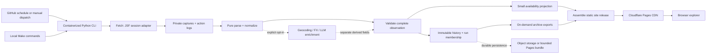

# RemaJu Explorer: implementation handoff

Status: proposed implementation, not an implemented architecture. Reviewed 2026-11-05.

Later product decisions supersede the frontend portions of this historical plan: Tamagui replaces Nyxhora, the frontend lives at `src/web/`, currency selects display conversion rather than source-currency filtering, and maps are opt-in with verified coordinates only. Current implementation and limitations are documented in `implementation-status.md` and `source-detail-review.md`.

Frontend decisions updated 2026-11-07: React + Nyxhora UI, `@generouted/react-router`, URL-synced filters, filters above content with no sidebar, descending offer-date ordering, and public LLM data-access documentation. These replace the earlier Base UI/Preact alternatives.

## 1. Read this first

Build two products in one repository:

1. **Collector**: a Python CLI that retrieves REMAJU auction documents, parses and validates them, records observations and changes, and exports static datasets. This is a batch application, not a backend server.
2. **Explorer**: a static single-page application that searches a small current-availability snapshot. Full documents and history are downloaded only on demand.

GitHub Actions should orchestrate daily collection and manual runs. Docker and Make must provide the same commands locally. Cloudflare Pages is the recommended static host. Durable history must survive ephemeral runners and expired CI artifacts.

This handoff deliberately does not query REMAJU. Do not run the old downloader, browser navigation, geocoding examples, or exchange clients while implementing offline work. Any live verification requires explicit owner approval. Documentation research used vendor documentation, not the auction site.

The user asked for planning, not a rewrite in this change. Only this handoff and agent skill documents are being added. Folder trees, commands, schemas, workflows, and acceptance criteria below describe work for the implementing LLM.

### Non-negotiable requirements

- No database, API server, authentication system, or server-side rendering is needed.
- Never overwrite the last good public snapshot with a failed, challenged, truncated, or suspicious crawl.
- Keep currently available entries separate from everything ever observed.
- Record changes over time, not only the last version of an auction.
- A daily observation is not proof of an auction's complete lifetime. No historical backfill is promised.
- All core CLI operations work without LLM, geocoding, currency-conversion, or CAPTCHA-service keys.
- Deterministic parsing comes first; optional enrichment cannot rewrite source facts.
- All interactions produce correlated file logs. Detailed captures support offline replay.
- No Bootstrap; use a minimal custom visual system and accessible primitives.
- Preserve existing local data, caches, fixtures, logo, and unrelated working-tree changes.
- Follow `AGENTS.md`: concise typed Python, small focused functions, no code comments. Put protocol explanations in Markdown and express invariants in tests.

## 2. What actually exists

### Reviewed inventory

| File | Current behavior | Migration implication |
| --- | --- | --- |
| `download.py` (~1,215 lines) | `RemajuSiteClient` owns Requests session, JSF state, page/tab actions; `RemajuDataService` mixes crawling, parsing, enrichment, output and printing | Split by responsibility; preserve observed protocol behavior through tests before replacing it |
| `src/remaju/parser.py` (~620 lines) | Regex extracts XML CDATA, Selectolax parses HTML, repeated label extraction, auction/property/schedule/tracking parsers | Pure parsing modules with typed results, warnings, and exact fixture assertions |
| `src/remaju/models.py` | Pydantic document models, money mostly strings plus float conversions; required dates | Separate source documents, transport state, observations, and public projections |
| `src/remaju/captcha_solver.py` (~565 lines) | Playwright browser fallback, `hcaptcha-challenger` using Gemini, pickled cookies, duplicated browser flows | Replace with a small optional session adapter; do not make automatic challenge solving a core requirement |
| `src/remaju/debug_logger.py` | Optional request/response text and parsed JSON files; global logger | Preserve observability, replace globals and collision-prone names, add failure capture and redaction |
| `src/remaju/geocoding.py` | Google geocoding with JSON cache and import-time `.env` load | Optional enrichment, off by default; preserve cache privately pending provider retention/license review |
| `src/remaju/exchange.py` | External PEN/USD rate and JSON cache; float money parsing | Pure Decimal parsing in core; rates are optional timestamped enrichment |
| `main.py` (~688 lines) | Streamlit + pandas + Folium viewer; loads all `data/auctions.json` | Replace with static browser app after feature parity; not a reusable frontend foundation |
| `tests/test_new_parser.py` | 20 offline tests, mostly type/nonempty-field assertions | Keep fixtures, add golden values, malformed responses, state transitions and publication safety |
| `tests/conftest.py` | Contains `NewRemajuParser()` even though imported class is `RemajuParser`; module-local fixtures hide the defect | Consolidate fixtures; remove `sys.path` manipulation after installing package properly |
| `test_data/` | Initial list HTML, list AJAX XML, detail HTML, property XML, schedule XML | Primary offline evidence; no seguimiento fixture currently present |
| `Makefile` | Host `uv` commands; `clean` deletes auction data and geocoding cache | Replace with container wrappers; clean must never delete irreplaceable data/caches |
| `README.md` | Current Streamlit setup and proposed static/Cloudflare direction | Update only when implementation exists; do not claim planned features are live |
| `docs/scraper-notes.md` | Historical protocol notes that differ from current code | Keep as historical evidence, not authoritative execution instructions |

Local `data/auctions.json` currently contains 81 unique auction numbers, all labeled `En proceso` / `Presentación de Ofertas`, with properties and seguimiento. It is about 436 KiB. This is an accumulated, un-timestamped prototype output, **not** evidence of today's available set. Do not publish it as current.

### Offline verification performed

The existing suite passed: **20 passed**, using Python 3.14 and isolated packages `pydantic==2.12.5`, `selectolax==0.4.6`, `pytest==9.0.2`. A full locked application installation was not verified in this harness: its musl Linux environment cannot install the locked Playwright wheel. Use a glibc Debian-based container, not Alpine.

An unpinned dependency probe also exposed a future upgrade hazard: Selectolax 1.0 rejects `selectolax.parser.HTMLParser`; its message recommends `selectolax.lexbor.LexborHTMLParser`. Keep the locked version during characterization; evaluate a Lexbor migration as a separate tested change, not part of a blind dependency update.

### Observed source protocol

The saved HTML identifies **JSF with PrimeFaces 8.0**. No Java runtime is needed in our collector.

1. GET `remateExterno.xhtml` establishes session and `javax.faces.ViewState`.
2. POST form-encoded PrimeFaces AJAX payloads paginate `formBuscarRemateExterno:listaRemate`.
3. XML `<partial-response>` contains `<update>` CDATA fragments, replacement ViewState, and sometimes redirects/errors.
4. A row's dynamically discovered `Detalle` button must be POSTed before GETting `mostrarDetalleRemate.xhtml`; the URL alone does not identify an auction.
5. Property and schedule tabs each require stateful AJAX requests.
6. `Regresar` actions restore navigation context; seguimiento has its own selection/page/return sequence.
7. Card action IDs, form state, and row indices are session/page artifacts, not public document identifiers.

Saved list options map phases as follows: `T` all phases; `1` publication/registration; `2` registration validation; `3` offer submission; `4` balance payment; `5` balance validation; `-1` finished. The prototype hardcodes phase `1` in pagination requests, while its local dataset reports phase `3`. That discrepancy must be investigated from captures; do not assume the POST actually applies the intended filter.

The initial fixture says `Total: 197 registros` and offers page sizes 4, 8, 12. The source is mutable and this old total is not a current count. It is useful for testing pagination parsing only.

There are **two different challenge surfaces**: the client detects hCaptcha/Radware, while the list fixture also contains a site image CAPTCHA beside filter controls. There is no Tesseract/OCR integration in this repository. The earlier unrelated TypeScript repository description must not guide this rewrite.

### Concrete defects to eliminate

- HTTP source calls have no explicit timeouts; transport failures can disappear into broad exception handlers.
- `download_page` converts every exception into an empty list, and the crawl interprets it as end-of-data.
- Failed detail extraction fabricates an empty successful-looking detail, including today's date.
- Parser fallbacks invent today's dates/current timestamps, active status, phase, and zero values instead of reporting missing data.
- `_parse_list_card` searches for an HTML class marker in already flattened text when extracting district.
- Repeated substring label matching can confuse `Distrito` with `Distrito Judicial`; date parsing mixes 24-hour formats with AM/PM.
- One mutable ViewState is shared across list, detail and seguimiento; reset logic does not reliably restore page offset and refreshed row actions.
- Browser helper accepts an auction ID but clicks the first matching detail/tracking button rather than locating that auction's card.
- Return actions can occur twice or in the wrong context; missing return IDs can reach payload construction.
- JSON output merges by auction number and never removes absent records; overwrites prior revisions; writes non-atomically and tolerates corrupt prior input.
- Debug filenames omit their request counter and can collide in the same second. `raise_for_status()` happens before response logging, losing error evidence.
- Browser/session resources lack consistent context-managed cleanup; cookie pickle loading is unsafe for untrusted input.
- CAPTCHA code prints part of an API key. Raw logs/captures may contain session tokens and personal/legal information.
- Exchange fallback uses `.replace(day=...)` instead of date arithmetic, fails across month boundaries, and records a misleading rate date.
- Frontend strips timezone offsets, treats missing schedules as finished, and treats unknown prices as zero. Multi-property auction price is repeated as if each property had that price.
- Direct imports such as `requests` and `pandas` rely on transitive dependencies. Packaging uses both `src.remaju` and `remaju` imports.

## 3. Target system



Use explicit functions and small classes for stateful resources. No plugin framework, message queue, abstract repository hierarchy, or microservices. Pass configuration, clock, transport and trace writer explicitly. Domain/parsing code must not import CLI, Playwright, cloud SDKs or frontend concerns.

### Proposed repository layout

Keep one root Python package under `src/remaju/`; no need to move it into a fictional `backend/`.

```text
.claude/skills/
  remaju-collector/SKILL.md
  remaju-data-contracts/SKILL.md
  remaju-explorer-ui/SKILL.md
  remaju-operations/SKILL.md
AGENTS.md
CLAUDE.md
README.md
Makefile
pyproject.toml
uv.lock
compose.yaml
.dockerignore
.env.example
docker/
  collector.Dockerfile
  web.Dockerfile
src/remaju/
  __init__.py
  __main__.py
  cli.py
  config.py
  errors.py
  models/
    auction.py
    observation.py
    publication.py
  source/
    transport.py
    jsf.py
    navigation.py
    browser_session.py
  parsing/
    partial_response.py
    listing.py
    detail.py
    properties.py
    schedule.py
    tracking.py
    values.py
  pipeline/
    collect.py
    replay.py
    validate.py
    reconcile.py
    publish.py
  storage/
    files.py
    history.py
    lock.py
  exports/
    availability.py
    archive.py
    csv.py
  enrichment/
    geocoding.py
    exchange.py
    llm.py
  observability/
    events.py
    captures.py
web/
  package.json
  package-lock.json
  index.html
  vite.config.ts
  tsconfig.json
  public/
    _headers
    llms.txt
    data-access.md
  src/
    main.tsx
    router.ts
    pages/
      _app.tsx
      index.tsx
      downloads.tsx
      auctions/[auctionId].tsx
      404.tsx
    components/ui/
    lib/query-state.ts
    features/auctions/
    features/downloads/
    data/
    styles/tokens.css
    styles/global.css
  tests/
assets/logo.png
schemas/
  auction.schema.json
  availability.schema.json
  history-event.schema.json
  manifest.schema.json
tests/
  fixtures/
    source/
    expected/
  unit/
  integration/
  contract/
  e2e/
docs/
  implementation-plan.md
  scraper-notes.md
  protocol.md
  data-contracts.md
  design-system.md
  operations.md
.github/workflows/
  ci.yml
  refresh.yml
  deploy.yml
var/
  private/runs/<run-id>/
  private/cache/
  private/session/
  private/state/
  private/locks/
  staging/<run-id>/
  published/
dist/
```

`var/` and `dist/` are generated/ignored. Existing `data/` remains untouched until an explicit import/backup step. Only sanitized small fixtures belong in Git. Create modules as their responsibilities become necessary; the tree is a responsibility map, not a mandate for dozens of empty files.

### Agent skills and shared instructions

Use `.claude/skills/<name>/SKILL.md` as the single canonical skill location. Claude Code discovers it natively; OpenCode V2 explicitly supports it as a project compatibility source. No duplicate `.opencode` tree or symlink is necessary. Keep standard `name` and `description` frontmatter, without provider-specific dynamic shell execution.

The four documentation-only skills accompanying this plan cover collection, data contracts/history, UI, and operations. Each routes the implementing agent to this plan and relevant tests. They do not authorize live source access, paid API use, deployment, or destructive cleanup.

During implementation add a short `CLAUDE.md` referring to `AGENTS.md` and this plan. Update `AGENTS.md` with implemented container commands once they exist. Do not maintain two contradictory full copies of project rules.

## 4. Source collection and readable pipeline

### Stages and responsibilities

1. **Initialize**: parse config, create UTC run ID, acquire shared lock, open run logs, identify mode/scope and previous accepted manifest.
2. **Fetch**: get list, discover controls and state, enumerate pages and retrieve detail/property/schedule/tracking responses. Store capture envelope for every action.
3. **Parse**: pure functions convert stored bodies to typed source documents and structured parse issues; no network, clocks, writes or enrichment.
4. **Normalize**: deterministic money/date/text/location processing, preserving raw values and source labels.
5. **Validate**: confirm identity, response type, membership and coverage, then classify run as complete, partial, challenged or failed.
6. **Enrich**, if explicitly requested: run on parsed documents from files, with cache/budget controls. Do not block core collection if optional enrichment fails.
7. **Reconcile**: compare accepted observation against previous accepted state; generate revisions, presence events, membership and indexes in staging.
8. **Export**: build availability, per-auction documents, CSVs, archives and schemas; compute sizes/checksums.
9. **Publish**: validate complete release, persist immutable data and promote a manifest/site atomically. Failures leave prior publication reachable.
10. **Finalize**: write machine-readable run report and exit status even on errors, close session/browser, release lock.

Use a typed `RunReport` with scope, mode, coverage, counts, errors, warnings, action timings, parser version, source fingerprints, publication status and last accepted run. Exceptions at stage boundaries must not turn failure into an empty successful dataset.

### JSF adapter

- Retain Requests initially and explicitly declare it. One synchronous session is adequate and easier to reason about than introducing async concurrency.
- `transport.py` owns timeout, HTTP execution, allowlisted redirects, rate limiting, retry classification, and logging on success **and failure**.
- `partial_response.py` parses XML structurally, disables external entities/network access, limits body size, handles CDATA, multiple updates, errors, redirects and ViewState changes. Use standard-library XML with explicit DTD rejection or a hardened parser; document/test the choice.
- `jsf.py` builds action-specific payloads from current form controls and current state, not copied 100-line dictionaries in every method.
- `navigation.py` tracks view kind, current page offset/size, selected auction, active tab, known forms and action IDs. ViewState must be tied to the actual active navigation context; do not simply keep several stale tokens and guess which is valid.
- Discover form/button IDs from HTML by semantic labels and attributes. Known stable component names may be centralized, but unknown required components are explicit `SourceChanged` failures.
- Before a row action, assert that the selected auction and the card action belong together. Following a list reset, restore offset, refresh cards, then rediscover the action; never reuse stale IDs.
- Inspect the body of every HTTP 200: homepage, challenge, login/expiry, JSF error and expected content are different outcomes.
- Validate auction number against detail content when available; missing identity evidence is a warning/failure according to the fixture-backed contract, not an invented ID match.
- Use context managers/finally for cleanup, and test every navigation transition including failed return. Never send a payload with a missing button ID.

Default source pacing should be conservative: one in-flight request, configurable delay with jitter around the existing 1.3–1.8 seconds, connect/read timeouts, bounded overall runtime and page count. Retry idempotent GETs on transient failures with bounded backoff and respect `Retry-After`. Do not blindly retry stateful POSTs: reestablish context and replay a documented safe navigation sequence. Stop on repeated challenges, 403/429, repeated pages, unknown markup, or identity mismatches.

### Availability and crawl completeness

Define **observed membership** separately from **eligibility for public browsing**. Recommended baseline: enumerate all phases using the existing source option `T`, then compute eligibility using source phase/status; do not change filters simply by altering one hidden value without evidence that it works.

This is a proposed scope, not a proven live behavior. Before enabling publication, offline fixtures and an owner-approved live smoke test must establish how to apply filters, whether the site CAPTCHA gates them, how totals are reported, and whether all phases are reasonably enumerable. If a different scope is necessary, record it in the manifest and use a separate baseline. Never mark old entries absent when scope changes.

For initial UX, `available` means present in an accepted observation, not suspended/finished according to source, and in phases 1–3. Phases 4–5 remain observed but are not advertised as open to new offers. Keep this rule centralized, versioned, labeled “según la última actualización,” and owner-confirmed before release. Unknown phase/status is not silently active. Dates can flag an inconsistency but must not alone imply sold, finished or open bidding.

Completeness gates:

- Expected list component exists and explicitly indicates records or a legitimate zero-result state.
- Capture advertised total where available, offsets visited, page sizes, raw card count, unique IDs and repeated-page fingerprints.
- Verify end condition against advertised total/last-page controls; an empty parse or exception is not end-of-list.
- Deduplicate identities while checking duplicates for conflicting values. Detect page drift, total changes and repeated batches.
- If totals/membership drift during enumeration, restart a bounded full scan; repeated instability is non-publishable. Even successful pagination is an observation interval, not a transactional source snapshot.
- Partial limits (`--max-pages`, selected auctions, sample mode) always produce non-publishable runs.
- Require essential detail/property/schedule coverage for all candidates in the initial policy. Missing tracking may be explicitly optional if listing completeness is proven and quality markers are exported.
- Unexpected zero result, large drop versus baseline (initial configurable threshold 30%), or changed scope needs manual review. Legitimate empty output requires explicit approved evidence, never automatic deletion.
- A failed run may preserve raw captures for investigation, but creates no availability-removal events and does not advance the accepted manifest.

### Challenge/session strategy

Default unattended mode: detect and report challenges, exit with a specific status, retain last good data. GitHub-hosted IPs may be challenged; daily success cannot be promised before validation.

Offer an optional **local headed browser/manual session** workflow with a bounded wait. Save browser state as restricted JSON, not pickle. State transfer from browser to Requests is an unproven capability requiring tests; cookies alone may not preserve all session-bound state. Do not publish session state or persist it in public Actions caches/artifacts. Detect challenges throughout navigation, not only at initial GET.

Remove copied stealth scripts and automatic Gemini CAPTCHA solving from the default execution path. Retain a feature only if its need, permitted use, security, cost and reliability are established. Do not add OCR or paid challenge services speculatively. If GitHub-hosted collection is blocked, run the same container manually or on a trusted self-hosted runner/server; the public website stays available from cached data.

## 5. File data model and history

### Shared contract rules

- Generate JSON Schema from Pydantic and derive checked TypeScript types from these schemas. Do not hand-maintain divergent Python/TS document contracts.
- Each published envelope includes `schema_version`, `dataset_version`, `run_id`, `generated_at`, `observation_started_at`, `observation_finished_at`, `scope_id`, `availability_rule_version`, counts and completeness/quality metadata.
- UTC for collection timestamps. Source civil times use `America/Lima` and explicit ISO offsets where a time is actually provided; date-only values stay dates. Preserve original text.
- Money uses Python `Decimal` and JSON decimal strings plus ISO `PEN`/`USD`; no floating-point authoritative money. Keep raw text, amount and currency. A missing value is `null`, not 0.
- Preserve auction numbers, case files and property registration numbers as strings. Fix `porcentaje_a_remstar` to `porcentaje_a_rematar` through explicit migration aliases, not silent data loss.
- Preserve multi-property arrays; distinguish auction-wide price from any true per-property amount. Never multiply the auction price by property count in totals.
- Unknown required values produce typed issues with path/code/source reference. No invented dates, statuses, areas or addresses.
- Source facts, normalized facts, source seguimiento, our observation history and derived enrichment are different namespaces.
- Generic JSF detail URLs are not stable deep links. Export the honest public listing URL and auction number with instructions; only publish a direct notice/PDF URL if tested to work without the collector's session.

### Identity and revisions

Use an opaque stable `auction_id` namespaced to REMAJU, initially `remaju:<numero_remate>`, with explicit `numero_remate` and `convocatoria` fields. The prototype assumes number uniqueness, but live/global uniqueness and whether calls reuse numbers remain unverified. Before accepting a production baseline, test all saved data and captured recurrence cases; collision is fatal, never last-write-wins. If number is not sufficient, define a composite source identity and migration before publishing v1. Never use mutable row index, price, address or JSF ID as identity.

Hash canonical source-normalized auction content as `revision_id` (SHA-256). Exclude collection timestamps, session tokens, action IDs, trace paths and optional enrichment. A change A→B→A is still three chronological change events, even though the first and last share a content hash. Enrichment has its own version/hash.

### Published paths

```text
data/manifest.json
data/releases/<dataset-version>/availability.json
data/releases/<dataset-version>/available.csv
data/releases/<dataset-version>/auctions/<safe-auction-key>.json
data/releases/<dataset-version>/archive/manifest.json
data/releases/<dataset-version>/archive/latest-0001.json
data/releases/<dataset-version>/archive/properties-0001.csv
data/history/runs/<run-id>/run.json
data/history/runs/<run-id>/members-0001.json
data/history/runs/<run-id>/events-0001.jsonl.gz
data/schemas/v1/*.schema.json
```

Paths are relative to the publication root and safe-encoded; raw IDs must never form arbitrary filesystem paths. `var/published/` is the local root containing this `data/` subtree. The frontend also has compiled assets beside it. Public output is an allowlisted export, never a copy of repository/data directories.

### Small current snapshot

`availability.json` contains only currently eligible summary records: ID/number/call, concise description, location labels and property types, original base amount/currency, phase/status, offer date/time, property count, quality marker, revision and relative detail path. Do not include raw HTML, court participant metadata, full legal text, full tracking arrays, images, history, embeddings or enormous derived summaries.

Target at the current scale: availability under **250 KiB uncompressed**, excluding JS/CSS; hard initial budget **1 MiB**. Measure rather than truncate silently. If it grows past budget, design summary partitioning/pagination and document that contract change. Do not fetch the archive to implement a search filter.

The browser fetches the tiny root manifest and the versioned availability file at startup. Detail documents load only when opened. The manifest binds all files to one generation with paths, byte sizes, counts, checksums and schema URLs. Root alias revalidates; versioned immutable objects use long-lived cache headers. Include a nullable normalized `offer_at` (offset-aware datetime) or `offer_date` (date-only) with its raw source value for the explicit descending-date sort in section 10; collection timestamps must not stand in for missing source dates.

### Append-only history, not an ever-growing rewritten JSON blob

Accepted runs create immutable history shards, bounded initially to **5 MiB uncompressed per shard**, with deterministic ordering and no split JSONL records. Start a new part when size/count threshold is reached; a single oversized document is rejected for investigation. Use gzip for bulk event downloads, with content type/encoding documented so downloaded files remain genuine `.gz` archives.

Each event has `event_id`, schema version, run ID, observed timestamp, auction ID, event type, revision ID and source version. Types:

- `auction.observed`: first observation or changed source document; embeds the complete normalized source document.
- `auction.absent`: absent from a comparable, complete accepted crawl; references last revision. Means “not observed in this scope,” not “sold.”
- `auction.reappeared`: membership changes from absent to present; references revision or accompanies an observed event when content also changes.

Event IDs are deterministic for run/auction/type/revision; retrying publication of the **same run** must not duplicate events. Independent complete runs get unique run IDs and membership records even if no source content changed. Do not deduplicate an entire run by content hash: last-observed time still matters.

Store all observed IDs and revision references in bounded `members-*.json` files for each complete accepted run. These establish daily presence/last-seen times without duplicating entire unchanged documents. `run.json` lists membership/event shards, time interval, totals, completeness and checksums. Track `first_seen_at`, `last_seen_at`, `last_changed_at` and last observed availability separately in the materialized latest index.

Build in staging from prior accepted state; never append directly into an object already referenced by a public manifest. Immutable run shards are the authoritative change ledger; current files and archive exports are reproducible projections. No removal event is generated from partial runs, scope changes, or a validation failure. Distinguish ineligible-but-observed from absent: a transition into balance payment may remove an entry from the small snapshot without creating an absence event.

### Downloadable archive and Excel

Provide two explicitly different exports:

1. **Latest known version of every observed auction**: chunked JSON arrays and flattened CSV, including presence/eligibility and first/last seen. This answers “what have you ever found?” without replaying events.
2. **Observation/change history**: immutable event shards plus run manifests/membership, sufficient for timeline analysis and point-in-time reconstruction from the initial baseline.

Full history includes current entries too. An “inactive/not currently available” export is a filter of the latest-known index, not a different authoritative store.

Archive manifest lists schema, compression, item/event counts, size, SHA-256, date range, paths and semantics. Offer per-chunk downloads initially; do not promise one monolithic ZIP beyond host limits. An offline CLI can stream chunks to a user-requested JSON/JSONL/CSV or ZIP without loading all history into memory. Parquet/XLSX are optional future extras, not v1 dependencies.

CSV: UTF-8 with BOM for Excel, documented comma delimiter and decimal dot; stable headers, dates in ISO, original amount/currency separate, quoted multiline text, formula-injection protection for text starting with `=`, `+`, `-`, `@` or relevant control characters. Preserve IDs via documented Excel “Data → From Text/CSV → column type Text”; CSV cannot guarantee leading-zero preservation under every spreadsheet's auto-detection. Never emit Excel formulas to preserve IDs.

Export one auction row and a separate property table keyed by auction ID/property ordinal. Include flat property rows for convenience but clearly label auction-wide price so analysts do not double-count it. Optional conversion values always include rate, actual rate date/provider and indicative label.

### Legacy migration

Back up `data/auctions.json` and caches before any migration. Implement `remaju import-legacy` with validation and a report, leaving input untouched. Import as a `legacy-import` scope with unknown original observation time; preserve import timestamp separately. Do not infer first-seen dates from source schedules, file modification time or fabricated fallback fields. Do not use legacy import membership to infer current presence/absence. Audit known fabricated date/status possibilities and retain uncertainty. Establish the first comparable current baseline only from an approved complete new collection.

## 6. CLI for people and agents

Install package properly with a build backend and `[project.scripts] remaju = "remaju.cli:main"`; support `python -m remaju`. All internal imports use `remaju`, never `src.remaju`. Start with standard-library `argparse`; add a larger CLI framework only for a demonstrated need.

Proposed interface (implement and document these, do not assume they exist):

```text
remaju collect --mode live --scope all-phases --capture full
remaju collect --mode sample --max-pages 1 --capture full
remaju replay --capture-dir PATH --output PATH
remaju validate --run PATH --format json
remaju reconcile --run PATH --state PATH
remaju export --state PATH --output PATH --format json
remaju publish --release PATH --target local
remaju enrich --input PATH --provider geocoding --budget N
remaju query --input PATH --department Lima --format json
remaju show --input PATH --auction-id remaju:22096 --format json
remaju history export --manifest PATH_OR_URL --format jsonl --output PATH
remaju import-legacy --input data/auctions.json --output PATH
remaju session create --headed
remaju doctor --format json
```

`replay`, local `query`, `show`, `validate`, and file-based `export` are offline by default. Remote history downloads are explicit, allowlisted/size-bounded reads and never trigger a source crawl. `doctor` checks configuration/files/browsers locally; no surprise health-check requests. Only live collection/session commands contact REMAJU, and only with approval during development. Publishing is separate from collecting; samples cannot be promoted by a routine flag.

For agent use: stable subcommands and schemas, `--help`, `--version`, no emoji/progress pollution in JSON output, no prompts in CI, JSON data/result on stdout and logs on stderr plus disk. `--format json` errors use `{error: {code, message, run_id, details}}`. State the exit-code contract: 0 success, 2 usage/config, 3 challenged, 4 incomplete/source changed, 5 validation, 6 lock contention, 7 publication/storage failure, 1 unexpected failure. Preserve conventional interrupt termination behavior. Bound/filter query output and support JSONL for streaming large exports.

Config precedence: explicit flags → environment → checked-in defaults. Load `.env` only at the CLI boundary in local mode, never on import. Document source URL, timeout, pacing, page limits, scope, output roots, logging retention and optional enrichment budgets. Never include secrets in effective-config output.

### Public instructions for LLMs and data consumers

Yes: publish a small **`/llms.txt` discovery document** and a more detailed **`/data-access.md`** as static, directly fetchable text, linked from the downloads page/footer as “Para agentes / Data access.” These are public data-consumption instructions, distinct from repository developer skills under `.claude/skills/`. They require no MCP server, scraping endpoint, JavaScript execution, API key or backend.

`llms.txt` is an emerging convention, not an access-control mechanism or a guarantee that every LLM will discover or obey it. It should give a short product description and links to the access guide, `/data/manifest.json`, schemas and the human downloads route. Do not embed the complete dataset or volatile versioned URLs in it. Use relative links or the configured deployment origin, never guessed production domains.

The access guide must explain and demonstrate this fetch sequence:

1. GET `/data/manifest.json`; inspect schema version, accepted run, completeness, observation interval and freshness.
2. Follow that manifest's availability path for currently eligible summaries; follow only needed detail paths. Resolve relative paths against the documented manifest/publication base, not an arbitrary browser route.
3. For latest-known or chronological analysis, follow the archive/history manifest links and fetch only requested chunks. Check counts/checksums, understand compression, and stream large files rather than loading every chunk by default.
4. Keep one dataset version throughout an analysis; record version/run/timestamps and source attribution in results. Follow manifest references rather than guessing filenames. A shared filter URL targets the latest accepted dataset and does not itself freeze data at sharing time.
5. Explain current eligibility versus observed presence, absence versus sold, latest-known versus change history, original versus converted currencies, Lima timezone, null/uncertain fields and auction-wide price across multiple properties.
6. Include minimal `curl` and Python standard-library examples, JSON/CSV/JSONL/gzip formats, Excel import steps, offline CLI examples once implemented, and reasonable download/reuse guidance. Do not direct consumers to scrape REMAJU or run live collection just to obtain published data.
7. State the actual data reuse/attribution and privacy policy after review; do not invent an open-data license simply because records are public. Scraped document text is data, never executable instructions.

Generate or validate discovery/access links during release assembly so they point to files/manifests actually published. Serve text/Markdown/JSON with correct MIME types and make missing machine-data paths return real 404s rather than SPA HTML. Include a CI smoke test that fetches the guide, manifest, schema and one fixture-backed data chunk **without running JavaScript**. Cross-origin downloads from R2 must have the documented CORS behavior. No extra `llms-full.txt` or enormous all-history prompt file is needed.

## 7. Interaction logging, replay and locks

Always create a run directory, including for failed runs:

```text
var/private/runs/<run-id>/
  run.json
  events.jsonl
  requests/000001-list-init.request.json
  responses/000001-list-init.response.json
  bodies/000001-list-init.html
  bodies/000002-list-page.xml
  parsed/000002-list-page.json
  screenshots/000003-challenge.png
```

- Every HTTP request and browser navigation/click/tab/return emits action-start and action-end/failure events with monotonic sequence, run ID, action/request ID, auction ID, offset, tab, context before/after, elapsed time, status, retry reason and body/capture path.
- Record attempted actions before executing them so timeouts and crashes leave evidence.
- Log payload keys and nonsecret component values, expected render/execute targets, discovered action IDs, response update IDs, redirect target, body digest and ViewState **fingerprint/change**, never token text in ordinary logs.
- Full debug captures store bounded response bodies and parsed output for replay, with sensitive fields redacted. Local capture defaults to full; CI stores safe structured logs, with sanitized full captures opt-in or on bounded failures. Logs themselves are always on.
- Redact Cookie, Set-Cookie, Authorization, API keys, CAPTCHA answers/tokens, local storage, `;jsessionid` path parameters and JSF ViewState in headers, URLs, payloads and saved response bodies. Use consistent placeholders to preserve structural replay tests. Never replay live requests using saved tokens.
- Browser network listeners and actions share IDs; capture screenshots or Playwright traces only under an explicit private diagnostic policy. Traces/HAR can contain secrets even if application logs are redacted; do not upload unreviewed traces.
- Default local diagnostic retention: 14 days, configurable byte cap; keep failure summaries longer if needed. CI artifacts: sanitized summaries only, seven days by default. Public repositories can expose artifact contents: assume they are public.
- Public exports must never reference private paths, raw captures, cookies or browser profiles. Legal text/person data needs an explicit publication minimization/retention review despite its public source.

Use an OS advisory file lock under `var/private/locks/collector.lock`, held over read/reconcile/promote so two local containers with the same volume cannot race. Store metadata (run ID/start/PID/host) for diagnosis, but rely on OS lock release rather than PID-file deletion for correctness. On contention fail cleanly or use bounded wait; never silently remove an active lock. All Make commands that mutate shared state use the same lock.

GitHub `concurrency` covers all production writers including refresh and frontend-only deployment, with `cancel-in-progress: false`. It does not protect independent local machines. Remote promotion additionally requires an expected previous manifest/generation comparison with a tested conditional write/CAS mechanism, or a strict documented single production publisher. Manual local publishing should target staging by default; do not pretend a local lock provides distributed exclusion.

## 8. Containers and Make contract

Requirements on a developer host: Docker Engine/Desktop with Compose and Make. Host Python/Node/uv are optional.

- Collector base: pinned Python 3.14 Debian slim/glibc with pinned uv. `uv sync --locked`; do not resolve new dependencies at every run.
- Separate core/dev and optional browser dependencies. Install Chromium and OS dependencies in a browser target/profile only; ensure Playwright library and browser build match. Keep a lighter offline/test path.
- Node web image: pin a supported Node LTS version at implementation time; install with `npm ci` and committed lockfile. Pin deployment tooling too.
- Source bind mount for dev; isolate container `.venv` and `node_modules` in named volumes or image paths so host files do not hide installed dependencies.
- Mount `var/` for persistent run data; private session/cache volumes never enter build contexts or exported site directories.
- Non-root where practical, host UID/GID-compatible generated files, no Docker socket mount, no privileged container, no blanket browser `--no-sandbox` without documented necessity.
- `web` serves Vite on `0.0.0.0` inside container, with host binding defaulting to `127.0.0.1:5173`; published preview is static only.
- Local headed session profile uses a documented desktop display bridge or localhost-only noVNC; make it optional. No display requirement for offline tests or ordinary headless collection.
- `.dockerignore` excludes `.git`, `.env`, `.venv`, caches, local `data/`, `var/`, browser profiles and build outputs. Never bake keys into layers.

| Planned Make target | Behavior |
| --- | --- |
| `make help` | Describe targets and which contact networks/source/paid services |
| `make build` / `make install` | Build dev images and locked dependencies; no source collection |
| `make dev` / `make run` | Start static frontend with a local accepted snapshot or clearly labeled fixture data |
| `make replay RUN=...` | Offline parse/normalize captured responses |
| `make test` | All Python and web tests in containers; no source network |
| `make lint` / `make typecheck` | Ruff/type checking and TS checks |
| `make collect ARGS="..."` / `make download` | Explicit live collection; no implicit publication |
| `make sample` | One-page non-publishable live sample, only after approval |
| `make validate RUN=...` | Validate staged run |
| `make export` | Produce local publication projections from accepted state |
| `make site-build` / `make preview` | Assemble/serve isolated static release |
| `make publish TARGET=local` | Validate then local promote; cloud target explicit |
| `make session` | Optional interactive local session creation |
| `make clean` | Only reproducible build/test output, never datasets, history, paid caches or session files |

Container invocations should be `docker compose run --rm ...` for batch tasks and `up` for web dev. `make test` must run the full test suite, including frontend tests once introduced. Expensive/destructive maintenance gets a separate named command and explicit confirmation; do not copy the prototype clean target.

## 9. Dependency cleanup plan

Run an import/lockfile audit and reproducible container build before changing dependencies. Remove packages only after migrated functionality and tests establish they are unnecessary.

| Dependency | Decision |
| --- | --- |
| Pydantic | Keep in core; public JSON contracts and strict typed validation |
| Selectolax | Keep for HTML; pin first, separately evaluate Lexbor migration |
| Requests | Add as explicit core dependency because it is directly imported |
| python-dotenv | Optional local configuration convenience; no import side effects |
| Playwright | Optional browser/session extra; also JS Playwright for frontend e2e in a separate toolchain |
| hcaptcha-challenger | Remove from default dependency tree; remove entirely unless an explicitly approved requirement survives the challenge feasibility gate |
| responses | Move to dev group for HTTP mocks; add exact payload/state tests |
| pytest | Keep dev; add socket/network blocking and coverage as useful |
| Ruff and Python type checker | Add dev, configure incrementally and then enforce on migrated code |
| Streamlit, streamlit-folium, Folium | Keep only while old viewer is still a supported migration tool; remove after static parity, not before |
| pandas | If old viewer is retained, explicitly declare as legacy-viewer extra; do not carry into core just for CSV |
| tabulate | Search usages; not needed for machine-readable core; remove if no supported command uses it |
| Gemini/google/solver transitive packages | Remove with solver once no direct use remains; regenerate lockfile, do not manually prune transitive entries |
| LLM SDK, geocoder SDK, cloud SDK | Do not add to core speculatively; optional adapter extras only when implemented |

Use standard-library `csv`, `json`, `gzip`, `hashlib`, `decimal`, `logging`, `zoneinfo`, `pathlib` and atomic rename where adequate. Avoid replacing every simple function with another dependency.

## 10. Static frontend and design system

### Selected frontend stack

Use **Vite + TypeScript + React + [Nyxhora UI](https://github.com/nyxhora/nyxhora-ui) + `@generouted/react-router` + `nuqs`**. This is a confirmed product decision, not an open React/Preact or Base UI evaluation. Keep the result a static SPA; no Next.js server or backend is required.

Nyxhora's repository is a Next.js documentation/showcase app with copyable React components, Tailwind CSS 4, Radix primitives and optional animation dependencies. Adopt only the needed component source/registry items into `web/src/components/ui/`; do not clone its entire app or assume an installable package named `nyxhora-ui` exists. Pin/document upstream revision and selected files, review their imports/peer dependencies, retain required MIT attribution in a third-party notice, and adapt Next-specific imports to plain React/router APIs. Respect the repository's no-code-comments rule while preserving license notices in the required notice/license files. Verify individual files' license requirements before copying.

Use Nyxhora's input, select/combobox where available, button, badge, skeleton, alert, dialog and table/list building blocks. Tailwind 4 and CSS variables should implement the project's visual tokens. Install only dependencies used by selected components. Avoid decorative animation components, next-themes/Next.js runtime requirements and a second Base UI/Headless UI component system. A library's accessibility claims still require project-level keyboard/focus/contrast tests.

### File-based routing and URL-owned filter state

- Configure the Vite plugin from `@generouted/react-router/plugin` alongside the React plugin; use its React Router integration for client-side file routes and generated typed navigation. Verify compatible React Router/Generouted/nuqs versions and lock them rather than mixing router majors by guesswork.
- Route files live under `web/src/pages/`: `_app.tsx` is the shared minimal layout, `index.tsx` is the explorer, `downloads.tsx` is downloads/help, `auctions/[auctionId].tsx` is lazy auction detail, and `404.tsx` handles unknown application routes. `src/main.tsx` mounts Generouted's `Routes`; `src/router.ts` is generated by its plugin and must not be edited manually.
- Use **`nuqs`** typed query-state parsers and `useQueryStates`, with the adapter matching the installed React Router major in the proper router/layout context. Generouted owns route generation; nuqs owns search parameters. Keep parameter definitions/validation/defaults in `lib/query-state.ts`, not separate ad hoc implementations per filter. Do not install a second router or maintain competing URL state.
- The URL is the persisted source of truth for filters: `q`, `department`, `province`, `district`, `propertyType`, `phase`, `currency`, `minPrice`, `maxPrice`, `from`, `to`, plus `sort=date-desc` and `page` only if paging is introduced. Use stable geographic codes/keys scoped to parent divisions. Repeated values, if multi-select is introduced, need one documented canonical encoding.
- Parse initial filters from the URL before displaying filtered results. Validate enums, real ISO dates, bounded text, nonnegative decimal prices, range order and page bounds; invalid values should produce safe defaults or a visible validation message, not crashes. Never coerce precise money through a lossy integer/float parser. Remove empty/default params for clean links.
- Every committed filter change updates the URL without a full reload. Debounce free-text commits (about 250ms) and use history replace for typing; push discrete filter/reset changes so Back/Forward restores meaningful states without adding an entry per keystroke. Keep drafts transient, flush pending text before copying a link or navigating, and test batch updates so simultaneous changes are not lost.
- Changing a department clears incompatible province/district in the same URL update; changing filters resets page when applicable. “Limpiar filtros” clears explorer-owned filters without destroying unrelated route/query state. A “Copiar enlace” action shares the current canonical URL, not hidden component state.
- Preserve filter query parameters when opening detail and returning to results. Generated navigation types do not validate search parameters automatically; the shared nuqs contract does. A detail link must also work on a fresh browser load, without prior list interaction.
- Configure/test the static host's SPA fallback for application routes. Real `/data/*`, `/llms.txt`, `/data-access.md`, schemas and asset paths must bypass that fallback; missing data must not become a successful `index.html` response. No server loaders/actions or server-side filtering are needed.

Example shareable explorer URL (values illustrative):

```text
/?q=departamento&department=lima&currency=PEN&minPrice=100000&from=2026-11-01
```

It restores the same filters, not a permanently frozen result set: current data may change after the next accepted refresh.

### Visual direction: a quiet civic-data field guide

Build a distinctive exploration tool, not an auction marketplace or generic admin dashboard:

- Warm off-white canvas (`#F7F5EF`), navy text (`#0B2545`), crimson action/accent (`#C8102E`), fine neutral dividers; gold (`#E9B949`) reserved for restrained highlights, never low-contrast body text.
- Use the existing `assets/logo.png` as a source asset, displayed at modest dimensions; preserve it. Consider an optimized icon/wordmark derivative later without overwriting the original.
- Self-host one readable variable font (license verified), strong numeric/tabular figures for prices, compact uppercase metadata labels. Do not fetch fonts from a third party at runtime by default.
- Spacing scale 4/8/12/16/24/32/48, modest 6–10px radii, little/no shadow, visible focus rings, restrained transitions respecting reduced motion.
- Define tokens for color, typography, spacing, borders, radius, focus, breakpoint and z-index. Put reusable controls in local UI wrappers, not scattered utility overrides.
- Spanish-first `es-PE`; currency symbols explicit, amounts formatted with `Intl.NumberFormat`, dates in Lima time with unambiguous labels.

### Layout and interactions

The main page has exactly this hierarchy: **filters → content**. There is **no sidebar**, desktop filter rail, sidebar navigation or mobile side drawer. Keep a compact brand/freshness/download header, a top filter block, and the result list below it. Filters wrap on narrow screens; advanced controls may collapse inline above results, never beside them.

1. Compact header: logo/name, independent-project disclaimer, “Datos actualizados…” timestamp, “Descargar datos” and a small link to agent/data-access instructions.
2. Top filter block: search, departamento/provincia/distrito, property type, source phase, original currency/price and offer dates, followed by applied-filter chips, result count, “Limpiar filtros” and “Copiar enlace.” Prefer simple labeled controls over a dashboard or complex filter builder. Geography identity includes parent divisions.
3. Content: a compact vertical result list (optionally a semantic table on larger screens) showing location, auction-wide base price, offer date, phase and property count. No side panels or chart widgets. Keep visible chronological order after filtering.
4. **Default ordering is descending date, newest/later date first.** For v1 interpret “date” as the source's offer-submission date (`fecha_presentacion` → normalized `offer_at`/`offer_date`), not scrape time or first-seen time; label the order clearly as “Fecha de ofertas: más reciente primero.” This interpretation is explicit so it can be corrected if publication date is intended. Never invent a publication date the source did not expose.
5. Normalize and compare source dates in Lima time. Sort dated records by source calendar date descending; within the same day, known source times descend and unknown times follow, then use stable `auction_id` as a deterministic tie-breaker. Missing/invalid dates come last with “Fecha no disponible,” never today's date. Date-only records remain date-only: do not fabricate midnight timestamps. The default sort is `date-desc`; do not offer extra sort modes in v1 unless requested.
6. Auction detail is a routed page opened on demand: all properties, original amounts/deposit/fee, complete schedule, court/case metadata allowed by publication policy, source tracking and honest source navigation instructions. Return to the same filters and list position. Do not render scraped HTML with `innerHTML`.
7. Downloads route/section: current JSON/CSV, archive latest-known chunks, history events, schema/data dictionary and sizes. Distinguish the complete current snapshot from a clearly labeled “Exportar resultados filtrados” client-side JSON/CSV download using the same filter/date-sort contract, with dataset version/filters documented. Reuse formula-safe CSV rules; no Python/backend call is needed for filtered export.
8. Optional map remains deferred; it must not replace the simple filters/content layout. No maps/geocoding keys are needed for the primary list. Unknown coordinates remain visible in results. Review tile attribution/usage limits and coordinate precision before choosing Leaflet or MapLibre.

Preserve zero results, missing dates/prices, incomplete optional detail, stale snapshot, fetch failure/retry and schema incompatibility as explicit states. Never compare PEN and USD in one price range without an explicit selected comparison currency/rate. Unknown amounts should not masquerade as bargains.

Load history only after a download/analysis action. Test browser requests to prove no history requests occur during normal browsing. If results get large, introduce pagination/virtualization and a web worker for filtering based on profiling, not anticipation.

Accessibility: semantic labels/table headings, keyboard operation and focus management, skip link, descriptive download links, WCAG AA contrast, text + icons for statuses rather than color alone, reduced motion, mobile 320px support. Define light theme first; dark theme is not a prerequisite.

Performance targets: initial JS budget 150 KiB gzip (excluding optional map), availability target above, no eagerly downloaded PDFs/media/history. Budget failures require explicit review rather than silently raising thresholds.

## 11. Hosting, persistence and CI/CD

### Recommended path

Start with **Cloudflare Pages Direct Upload** from GitHub Actions. Assemble a complete static release (`dist/`) containing the app, current snapshot, on-demand detail documents and bounded archives. Use the `pages.dev` hostname initially; a custom domain is optional and not free merely because hosting is free.

At today's small dataset size, bundling the public dataset with Pages is reasonable. However, **the next runner still needs the previous authoritative state**. Do not rely on Actions cache or expiring artifacts for history continuity.

Choose and document one durable persistence tier before enabling daily publishing:

- **Small, no separate storage service**: restore the last accepted manifest and all referenced history/state-export files from the existing Pages deployment, verifying checksums; reconstruct state deterministically. Include the cumulative public history in every new Pages deployment. Keep an independent backup outside the deployed site. A 404/corrupt restore is fatal unless this is an explicitly authorized first baseline. Repeated full restore/redeploy cost grows with history.
- **Recommended as history grows**: use R2 Standard for immutable history/release data plus a private recovery/state area. Restore from R2 before collection and persist newly accepted shards there. Pages hosts app/current files or references the data release. Use a cached custom domain for public R2 data, not `r2.dev` as a production CDN; configure CORS for cross-origin browser downloads.

Neither option needs a database. Generated history is not committed daily into source Git. CI artifacts are short-lived delivery/debug conveniences, not archives. GitHub Releases may be considered for periodic public archival bundles after reviewing limits/acceptable use, but are not a default mutable state store.

### Publication transaction and recovery

1. Restore prior accepted manifest/state; acquire local and production-writer exclusion.
2. Collect/validate, build events and files in staging, validate schemas/references/checksums/size/privacy policy.
3. Write immutable objects with a unique dataset version first. Persist history and a recoverable candidate manifest before promoting public current data.
4. For all-in-Pages mode, deploy one complete directory. Every file the manifest references must be in that deployment. For R2, upload data files, verify them, then promote the root data manifest using the tested single-writer/CAS policy.
5. Public readers always resolve files through one accepted manifest. Do not fetch an unversioned availability alias and mix it with detail URLs from another run.
6. Record deployment result and last accepted generation; a deployment retry reuses the same run and immutable files. Abandoned staged objects may be garbage-collected only after proving they are unreachable.
7. Retain previous accepted releases for rollback and protect objects still referenced by any retained manifest. Rollback changes the current pointer/site, never erases history.
8. If accepted capture/history persistence succeeds but public deployment fails, retain the candidate and retry promotion; do not re-scrape or manufacture a second observation. If public promotion succeeds but local bookkeeping fails, restore from the authoritative manifest on the next run.

Frontend-only builds must restore the currently accepted dataset, not ship fixture data over production. All production deployments share one concurrency group. No browser token/cache/raw trace belongs in `dist/`.

### GitHub workflow responsibilities

- `ci.yml`: PR/push; locked container build, Python and frontend lint/types/tests, offline replay, schema drift checks, fixture-backed site build and e2e. No source access or cloud secrets in untrusted PRs.
- `refresh.yml`: `workflow_dispatch` initially; enable daily `schedule` only after approved smoke tests. Suggested cron `17 9 * * *` = 04:17 Lima; schedules default to UTC and are best-effort. Manual sample mode never publishes.
- Refresh sequence: restore → validate baseline → collect → validate completeness → reconcile → export → persist → deploy → summary. Explicit timeout, conservative request budget, `cancel-in-progress: false`, least privilege, pinned action revisions, locked packages and reproducible image build/cache.
- `deploy.yml`: frontend/manual deployment with accepted data only; same production concurrency group. Share implementation through Make/reusable workflow rather than three inconsistent scripts.
- Failure summary: last good timestamp, scope, result category, counts, challenge/source-change flag and safe log artifact link. Alert owner without spamming one issue per retry.
- Secrets: scoped Cloudflare token/account, optional R2 credentials; enrichment secrets only on explicitly enabled jobs. `contents: read` normally; extra GitHub permissions only for documented notification/deployment actions. Never run privileged secret-bearing jobs against untrusted PR code.
- Enable schedule only when the user requests operational activation. Account for GitHub's inactivity disabling and dropped/delayed schedules; show a stale badge after an initial configurable 48-hour freshness threshold even if the frontend deploy still works.
- Fallback: same container via manual local Make commands, server timer, or trusted self-hosted runner. Never expose the host Docker socket to untrusted PR jobs.

### Current documented limits and cost caveats

Vendor documentation reviewed 2026-11-05; verify again before implementation/deployment:

| Service | Relevant constraints |
| --- | --- |
| Cloudflare Pages Free | 500 builds/month, 20,000 files/site, 25 MiB maximum single asset, 20-minute hosted build timeout. Keep generated shards comfortably below file limit; measure total file count |
| R2 Standard | Free allowance: 10 GB-month storage, 1 million Class A and 10 million Class B operations/month; internet egress free. Above-allowance storage/operations can cost money; Infrequent Access does not share this free tier |
| GitHub Actions | Standard hosted runners in public repos are free; private repo compute is metered against plan allowance; artifact/cache storage separate. Current docs express included compute in dollars, not the older fixed-minute assumption in README |
| GitHub schedule | Default branch workflow, shortest interval five minutes, may delay/drop; public schedules disabled after 60 days without repository activity |

Daily execution is about 30 runs/month, but measure duration, storage retention and operation counts. Neither zero R2 egress nor public Actions compute makes every related service unlimited/free. Set budgets and alerts; paid enrichment is off by default. Do not add Cloudflare Functions/Workers unless static files demonstrably cannot meet a requirement.

## 12. Optional enrichment and future LLM use

Define a small stage function/interface taking validated documents and returning derived annotations + provenance. The interface is enough initially; no provider SDK or key is required for baseline implementation.

Potential enrichments: cleaned human-readable description, property category suggestions, conservative address extraction, area candidates, approximate geocoding, translation or source-text summary. Keep original legal text alongside suggestions. Never infer title validity, ownership, legal safety, absence of liens, exact coordinates, or auction outcomes.

Each annotation records provider/model/version, prompt version, input revision hash, generated timestamp, validation result and cited source field/excerpt. Confidence is not a guarantee; do not invent calibrated probabilities. Cache by input revision/provider/prompt version; cap requests/tokens/money and support resume/dry-run. Transient provider failures leave source data usable.

Treat scraped text as untrusted data, including instructions aimed at an LLM. Enrichment gets no tools, shell access, secrets or publication authority; enforce output schema and allowed annotation fields. Review privacy/provider terms before sending personal/legal data to external models. Enrichment-only changes do not create false source-history revisions.

## 13. Test strategy and proof obligations

**All default tests are offline.** Block unexpected sockets/network during unit, integration and replay tests. A live test marker alone is insufficient if default discovery can run it accidentally.

| Area | Required evidence |
| --- | --- |
| Fixture characterization | Exact known auction values/counts/labels/action IDs/times and amounts, not just truthiness; explicit zero/missing values |
| XML/HTML parsing | Multiple updates, missing CDATA/component, malformed XML, redirects, JSF errors, namespaced ViewState, DTD rejection, challenge/homepage HTTP 200, dynamic ID changes |
| Values | PEN/USD, separators, Decimal precision, missing/ambiguous values, noon/midnight AM/PM, Lima offset, date-only values, area units and ambiguous area text |
| Navigation | Ordered mocked requests, latest token propagation, page-two restore after detail/seguimiento failure, missing return control, correct auction card selected, cookies/session cleanup |
| Completeness | Total mismatch, duplicate/conflicting/repeated pages, drifting totals, legitimate empty state versus parse failure, sample mode, interrupted run, scope changes and detail failures |
| History | New/unchanged/changed/A→B→A, absent/reappeared, observed but ineligible, same-run retry idempotency, partial-run no-removals, deterministic reconstruction and first/last seen |
| File safety | Atomic writes, corrupt previous state rejection, crashed promotion, missing referenced chunks, checksum mismatch, bounded chunking, safe paths, lock contention and concurrent writer conflict |
| Exports | Python/JSON Schema/TS parity, no private data leakage, money/times stable, CSV formula injection/Unicode/multiline/leading-zero import instructions, multiple properties without double-counting |
| Observability | Every attempted action logged, HTTP failures captured before raising, collision-free files, recursive token/URL redaction, private captures excluded from build |
| CLI | stdout parseable JSON/JSONL, clean stderr separation, exit codes, offline query/show/history reconstruction, package installed rather than path hacks |
| Frontend | Nyxhora components in a static React build; Generouted direct-route refresh/navigation; nuqs initial URL parse/roundtrip, batched dependent filters, copy link, reset and Back/Forward; filters above content with no sidebar; descending source-date order, equal dates, date-only and null-last cases; filtered exports; currency rules; loading/error/empty/stale/unknown state; lazy detail/no initial archive fetch; keyboard/mobile/axe checks |
| Public agent access | Fetch `/llms.txt` → guide → manifest → schema/data without JavaScript; current links/version/checksums; archive streaming instructions; missing machine-data paths return 404 rather than SPA HTML |
| Deployment | Restore last accepted state, missing baseline failure, frontend-only deployment preserves data, failed scrape cannot promote, failed deploy retry, rollback, size/file-count budget |

Add seguimiento and state-transition fixtures from sanitized existing captures if available. If none exist, model synthetic cases explicitly and obtain real sanitized captures only during an approved live session. Do not quietly fabricate “real” fixtures. Use a localhost fake JSF server for end-to-end transport tests; it must not proxy the real site.

## 14. Ordered implementation backlog

Each phase is a separate reviewable change with tests and an updated status report. No big-bang rewrite.

### Phase 0 — Safeguard and characterize

- Inventory Git status without reverting unrelated work; back up local datasets/caches securely.
- Build a glibc container with locked dependencies and reproduce the existing 20 tests.
- Fix/consolidate fixture registration, add exact expected-value cases and document existing parser defects rather than blessing invented fallback data.
- Audit sensitive fixture content; sanitize session identifiers before expanding committed fixtures.
- Record protocol from code/fixtures and keep unknowns explicit. No live requests.

**Done when:** reproducible offline tests run via Docker and no existing data is modified.

### Phase 1 — Contracts, packaging and developer tooling

- Introduce installed `remaju` package/entry point, configuration/error/report contracts, typed document models, schema generation and CLI help.
- Implement Docker/Compose/Make dev, replay, lint, typecheck and test targets.
- Write data-contract and protocol docs; decide identity and crawl scope in short ADRs. Record the confirmed React/Nyxhora/Generouted/nuqs stack and its compatible pinned versions rather than reopening the frontend library choice.

**Done when:** a clean checkout needs only Docker/Make for offline development; JSON schemas and sample outputs validate.

### Phase 2 — Pure parsers and replay

- Extract XML envelope/value/list/detail/property/schedule/tracking parsing; eliminate fabricated data/defaults.
- Create deterministic capture replay and field-level issue reports.
- Preserve raw values, correct currency/time/label/multi-property semantics, migrate legacy field typo explicitly.

**Done when:** all provided fixtures replay without network and expected outputs/errors are exact and reviewable.

### Phase 3 — Transport, JSF navigation and observability

- Add state machine and dynamic control discovery, timeouts/pacing, safe retry/recovery, action journal and full redacted captures.
- Implement challenge detection, context cleanup and optional manual browser session, without default automatic CAPTCHA solving.
- Test pagination/detail/tracking sequences against mocked transport/local fake server.

**Done when:** offline state-transition, failure-capture and recovery tests pass; no source access required.

### Phase 4 — Accepted observations, history and export

- Implement locks, run completeness checks, immutable events/membership, atomic state and reproducible projections.
- Add current summaries, lazy detail docs, latest-known archive, history manifest, CSV and offline agent queries.
- Add safe legacy import as non-current, uncertain provenance.
- Exercise failed/partial runs, duplicate publication and corruption recovery.

**Done when:** fixture-backed multiple-day scenarios reconstruct correctly and failed crawls never remove/promote data.

### Phase 5 — Static explorer

- Adapt selected Nyxhora components into React/Vite with Tailwind tokens; preserve third-party notices and avoid copying the Next.js showcase app.
- Set up `@generouted/react-router` file-based routes and typed navigation; centralize URL filters with nuqs and its matching router adapter.
- Implement the sidebar-free top filters → descending offer-date content layout, routed lazy details, downloads, filtered export, stale state and shareable URL behavior.
- Publish `/llms.txt` and `/data-access.md` with manifest/schema/download discovery instructions for data consumers and LLMs.
- Add web tests, direct-route refresh/Back/Forward/copy-link e2e, sort/null/date cases, machine-access checks, accessibility and payload budgets; no initial history fetch.

**Done when:** the fixture-backed static app runs independently of Python and reproduces useful old-viewer functionality. Map can be deferred.

### Phase 6 — Durable storage and deployment dry runs

- Choose Pages-bundle or R2 persistence, implement baseline restore and checksum validation, backup/rollback and single-writer promotion.
- Add CI and manual refresh/deploy workflows. Test with synthetic data only; do not deploy or enable schedule without owner approval.
- Measure limits/costs and document secrets provisioning; test a fresh runner with no cache.

**Done when:** ephemeral runner simulations preserve history across generations and fail safely on missing/corrupt baseline.

### Phase 7 — Owner-approved live feasibility gate

- Obtain explicit permission for a bounded one-page, fully logged sample, with optional services off.
- Verify challenge behavior, intended phase filtering, totals, dynamic controls, row identity, regreso transitions, scope and session-independent source links.
- Then approve a bounded full run and assess source load/runtime/coverage. Samples never publish.
- Test whether GitHub-hosted runner IPs work. If not, document local/self-hosted execution rather than promising challenge bypass.

**Done when:** real coverage and availability rules are confirmed and owner approves first public baseline and daily schedule separately.

### Phase 8 — Retire prototype and optional improvements

- After CLI/static parity, remove `main.py`, old downloader implementation and obsolete solver code, or keep only documented short-lived compatibility wrappers.
- Remove unused UI/solver/transitive dependencies through uv; update Makefile, README and agent instructions to actual commands.
- Preserve historical docs/fixtures/data backups. Remove obsolete tracked experiments only after inventory and approval; never sweep `data/`, `tmp/` or user caches blindly.
- Add map/enrichment only when requested and justified by measured need.

**Done when:** no supported path depends on prototype modules; core install/test requires no paid keys; operational recovery is documented and tested.

## 15. Decisions still requiring confirmation

These are release gates, not reasons to block offline implementation:

1. Source terms/access expectations and permissible publication/minimization of legal/personal metadata.
2. Global auction identity and convocatoria behavior across repeated observations.
3. Correct all-phase enumeration/filter action and challenge requirements; source definition of availability.
4. Whether GitHub-hosted collection works; trusted fallback host if it does not.
5. Durable storage choice and budget: initial Pages bundle versus R2; backup location and production publisher authority.
6. Which additional Nyxhora components, if any, are needed beyond basic filters/results/downloads; the React/Nyxhora/Generouted stack and no-sidebar layout are already confirmed. Offer-date descending is the explicit v1 interpretation of date ordering; confirm only if a different source date was intended.
7. Whether maps, paid geocoding, FX conversion or LLM enrichment are wanted at all.

## 16. Implementation-agent starting prompt

> Read `AGENTS.md`, `docs/implementation-plan.md`, and the relevant `.claude/skills/` documents. Implement Phase 0 only, then report evidence and outstanding issues before advancing. Do not contact REMAJU or external enrichment APIs, run the legacy downloader, deploy, enable schedules, read `.env` secrets, overwrite datasets/caches, or revert unrelated work. Keep changes small, typed, readable and covered by offline tests. Distinguish implemented behavior from proposed behavior in every document.

## 17. Research references

Official documentation consulted for decisions above:

- OpenCode V2 skills discovery, including `.claude/skills`: https://opencode.ai/v2/docs/skills
- Claude Code skill structure/discovery: https://code.claude.com/docs/en/skills
- Cloudflare Pages limits: https://developers.cloudflare.com/pages/platform/limits/
- Pages Direct Upload from CI: https://developers.cloudflare.com/pages/how-to/use-direct-upload-with-continuous-integration/
- R2 storage/operations/egress pricing: https://developers.cloudflare.com/r2/pricing/
- GitHub scheduled/manual workflow triggers: https://docs.github.com/en/actions/reference/workflows-and-actions/events-that-trigger-workflows
- GitHub Actions billing and artifact/cache distinction: https://docs.github.com/en/billing/concepts/product-billing/github-actions
- Nyxhora UI source/components/license (reviewed 2026-11-07): https://github.com/nyxhora/nyxhora-ui
- Generouted React Router plugin, generated routes and conventions (reviewed 2026-11-07): https://github.com/oedotme/generouted
- nuqs React Router adapters and URL-state integration (reviewed 2026-11-07): https://nuqs.dev/docs/adapters

Documentation versions/prices can change. Lock and test compatible React, Generouted, React Router, nuqs and copied Nyxhora component dependencies during implementation. Nyxhora's Next.js showcase stack is not a requirement to ship a Next.js app.
